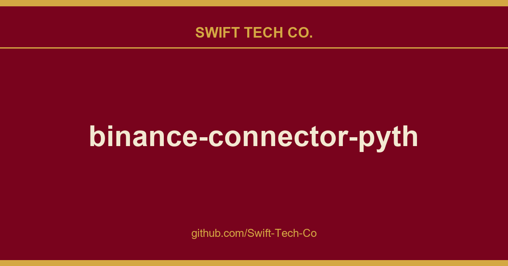

# binance-connector-python

## What This Is

A practical reference entry for product and engineering: the binance-connector-python notes, examples and fixes we reach for repeatedly. Kept current as part of the wider Swift Tech Co. engineering library.

## Images

## Sources

Compiled and maintained from upstream [binance/binance-connector-python](https://github.com/binance/binance-connector-python) under permissive open-source license.

---

Maintained by [Swift Tech Co.](https://github.com/Swift-Tech-Co) - [Telegram](https://t.me/+Qt_eFvkb2rliMzNh)

## Sources

Compiled and maintained from upstream [binance/binance-connector-python](https://github.com/binance/binance-connector-python) under permissive open-source license.

---

Maintained by [Swift Tech Co.](https://github.com/Swift-Tech-Co) - [Telegram](https://t.me/+Qt_eFvkb2rliMzNh)